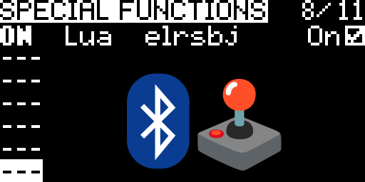

# edgetx-elrs-bluetooth-joystick

[EdgeTX](https://edgetx.org/) script to start [ExpressLRS](https://www.expresslrs.org/) bluetooth joystick
when a model is selected.

⚠️ The script has been mostly generated by malevolent robot and reviewed by incompetent human. Use with caution.

## Requirements

EdgeTX radio with a ESP32-based ExpressLRS module. If you can [enable BLE joystick](https://www.expresslrs.org/quick-start/transmitters/lua-howto/#ble-joystick-esp32-txes-only)
from `elrs.lua` then this script should also work.

## Setup

* Copy `elrsbj.lua` to `/SCRIPTS/FUNCTIONS` on radio's SD card (or internal flash).
* Create a dedicated model.
* In model settings, add a [Special Function](https://manual.edgetx.org/bw-radios/model-select/special-functions):
  * Trigger: `ON`
  * Function: `Lua`
  * Script: `elrsbj`
  * Repeat: `On`
  * Enable: checked

## Notes

* Selecting different model turns the joystick off, as EdgeTX restarts the RF module when switching models.
* If the joystick could not be started, the reason is written to `/LOGS/elrsbj.txt`.
* This is meant to be used with a model dedicated to simulator flying. The actual radio link is disabled
  when BLE joystick is active.
